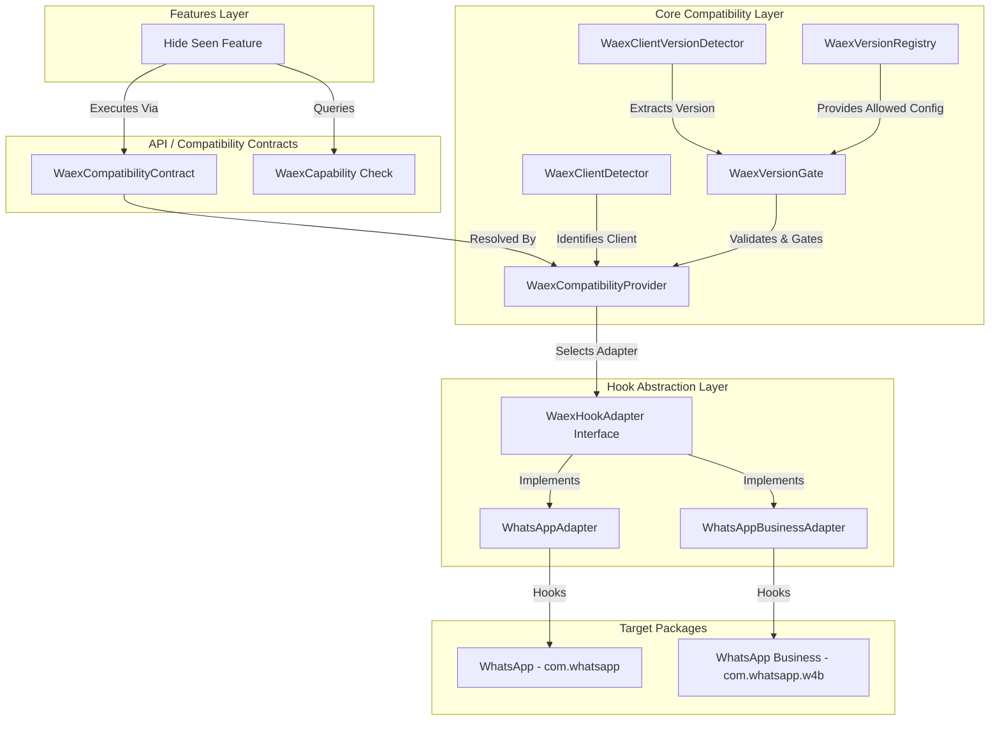
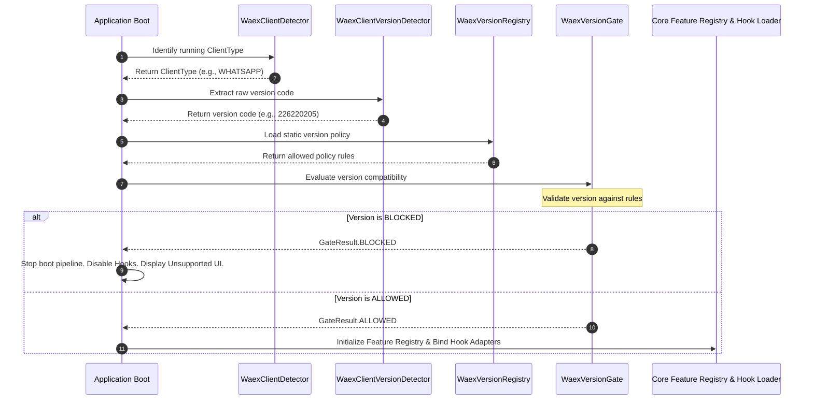
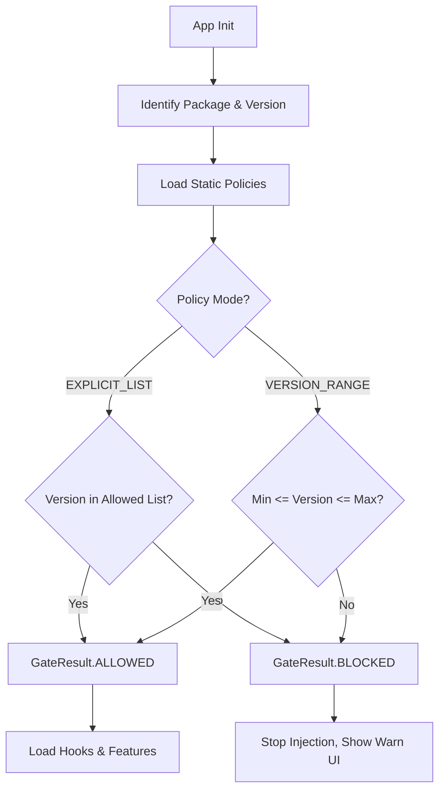
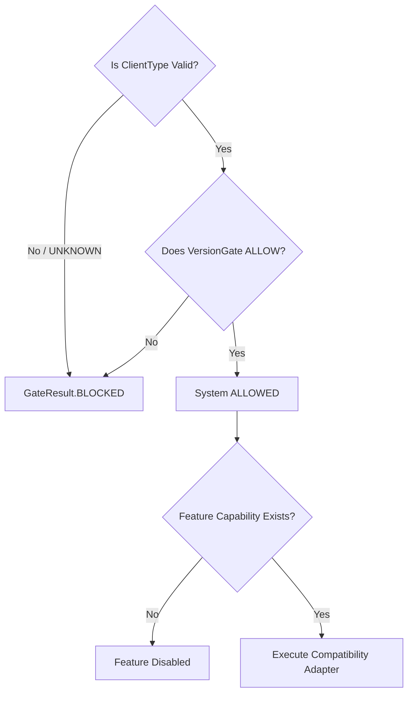

# WAEX Multi-Client Compatibility Architecture

This document defines the architectural specifications for the **WAEX Multi-Client Compatibility Layer** and the **Manual Version Compatibility Gate (Strict Enforcement Layer)**. This system isolates features from target packages and strictly gates WAEX initialization based on allowed client versions.

---

## 🏛️ Architecture & Component Design

The compatibility layer decouples features from target clients using a provider-adapter pattern. The Feature layer queries capabilities instead of package names, ensuring that target application dependencies never leak into business logic. The Version Gate validates target versions *prior* to hook attachment or registry initialization.



---

## 1. Supported Client Model

The `ClientType` enum classifies supported clients anonymously:

```java
package com.waenhancer.api.contracts;

public enum ClientType {
    WHATSAPP,
    WHATSAPP_BUSINESS,
    FUTURE_CLIENT,
    UNKNOWN
}
```

*   **WHATSAPP** & **WHATSAPP_BUSINESS**: Primary supported clients from day one. Both are treated as first-class citizens.
*   **FUTURE_CLIENT**: Open namespace for custom target builds, third-party forks, or clones.
*   **UNKNOWN**: Default fallback when signature validation or package identity checks fail.

---

## 2. Client Detection & Version Extraction Layers

The detection subsystem executes during application boot to identify the hosting environment:

### A. Client Detector (`WaexClientDetector`)
*   **Installed Clients Detection**: Scans the device package manager to list available targets.
*   **Running Client Detection**: Identifies the package name and process path currently hosting the hook engine.
*   **Metadata Extraction**: Extracts the package signature certificate and installer origin.
*   **Status Isolation**: Prevents the feature layer from accessing package names or calling detector APIs directly.

### B. Client Version Detector (`WaexClientVersionDetector`)
*   **Package Version Extraction**: Extracts the raw `longVersionCode` and version string from the target application's `PackageInfo`.
*   **Version Normalization**: Converts various platform-specific version structures into a standard unified format (`Long` representation).
*   **Anonymity Rule**: Reports raw data only; it does not perform any version validation or compatibility decisions.

---

## 3. Version Registry Layer (`WaexVersionRegistry`)

The `WaexVersionRegistry` serves as the central, read-only configuration repository:

### Responsibilities
*   **Static Configuration Ingestion**: Loads allowed version data parsed from `client-version-policy.md` during application boot.
*   **Constraint Checking**: Exposes query APIs to fetch version limits (`minVersionCode`, `maxVersionCode`, and `allowedVersions` set) matching a specific `ClientType`.
*   **No Runtime Modification**: The configuration registry is strictly immutable at runtime. No hot-reloads or overrides are permitted.

---

## 4. Version Gate Enforcement (`WaexVersionGate`)

The `WaexVersionGate` acts as the core gating layer, outputting a strict binary decision (`ALLOWED` or `BLOCKED`):

```java
package com.waenhancer.core.compatibility;

public enum GateResult {
    ALLOWED,
    BLOCKED
}
```

### Validation Algorithm
1.  Query `WaexClientDetector` to identify active `ClientType`. If `UNKNOWN`, return `GateResult.BLOCKED`.
2.  Query `WaexClientVersionDetector` to extract target version code.
3.  Query `WaexVersionRegistry` for version constraints matching `ClientType`.
4.  If the policy mode is `EXPLICIT_LIST`:
    *   Return `ALLOWED` only if the version code is explicitly included in the `allowedVersions` list. Otherwise, return `BLOCKED`.
5.  If the policy mode is `VERSION_RANGE`:
    *   Return `ALLOWED` if the version code is inclusively between `minVersionCode` and `maxVersionCode`. Otherwise, return `BLOCKED`.
6.  For any check failure or parsing exception, fail closed and return `GateResult.BLOCKED`.

---

## 5. Early Boot Enforcement Rule

Version gating is executed at the earliest possible lifecycle event during application boot:



---

## 6. Compatibility Layer (`WaexCompatibilityProvider`)

The `WaexCompatibilityProvider` is the central runtime router, coupling client capability checks with version gate validation:

### Responsibilities
1.  **Strict State Guarding**: Returns `false` for any capability check if the `WaexVersionGate` is `BLOCKED`.
2.  **Resolve Active Adapter**: Instantiates the correct `WaexHookAdapter` implementation matching the running client type.
3.  **Unified Interface**: Serves uniform interfaces to the feature layer so that code executes identically across different targets.

---

## 7. Feature Isolation Rule Update

Features are strictly decoupled from target application environments:
*   Features must never access version details, detectors, or version gates directly.
*   Features check compatibility only via:
    ```kotlin
    if (compatibilityProvider.isFeatureAvailable(featureId)) { ... }
    ```
    This method internally validates that `ClientType` is valid, the capabilities are supported, and `WaexVersionGate` evaluates to `ALLOWED`.

---

## 8. Visual System Diagrams

### Version Gate Flow Diagram


### Client + Version Decision Tree


---

## 🚀 Future Scalability & Version Impact

The gating architecture scales smoothly with client changes:
*   **Zero Feature Overhead**: Version rules are updated inside `client-version-policy.md`. Adding or removing version support requires no feature-layer code modifications.
*   **O(1) Version Onboarding**: To support a new client update, add its version code to the registry policies. The rest of the pipeline handles resolution automatically.

---

## 🛡️ Failure & Risk Analysis

### 1. Failure Scenarios

*   **Scenario A: Invalid/Experimental Version Code**
    *   *System Behavior*: If WhatsApp Business is updated to an unsupported beta version (e.g. version code `226220800`), the `WaexClientVersionDetector` extracts the code, and the `WaexVersionGate` detects that it exceeds the policy's `maxVersionCode`.
    *   *Result*: System resolves to `BLOCKED`. All hook engines disable, and WAEX launches in a sandboxed, warning-only configuration.
*   **Scenario B: Version Downgrade**
    *   *System Behavior*: If the user downgrades the target client below the `minVersionCode` to attempt to bypass hooks protection.
    *   *Result*: The `WaexVersionGate` compares version codes and blocks initialization immediately.
*   **Scenario C: Spoofed Package Identifier**
    *   *System Behavior*: A clone package identifies itself as `com.whatsapp` but uses signature hashes that do not match the official WhatsApp certificate registry.
    *   *Result*: `WaexClientDetector` flags signature verification failure, maps the target client to `UNKNOWN`, and the gate resolves to `BLOCKED`.

### 2. Bypass Risks & Mitigations

*   **Tampering with Policy Configuration**:
    *   *Risk*: A user modifies the local preference files to spoof version gating values.
    *   *Mitigation*: The policies are stored in the static assets folder or parsed directly from compiled resources in `client-version-policy.md`. These files are protected by standard APK signature integrity checks, preventing post-compile modification.
*   **Runtime Memory Mocking**:
    *   *Risk*: A user employs memory tools to overwrite return values of `WaexClientVersionDetector`.
    *   *Mitigation*: The boot flow runs inside the target application's process space under hook engine authority, using native JNI methods to extract package metadata directly from the operating system's `PackageManager` system bindings.

---

## 📋 Final Architecture Audit & Enforcement Checklist

### Architecture Compliance Audit
1.  **Early Check Enforcement**: Verified. The system initializes `WaexVersionGate` at step 4 of the boot pipeline, prior to executing feature registrations or adapter injections.
2.  **Binary State Outcomes**: Verified. The decision layer evaluates to binary `ALLOWED` or `BLOCKED` results. No partial states or bypass routes exist.
3.  **Strict Isolation**: Verified. Feature modules depend only on `com.waenhancer.api.contracts` and can access version status only indirectly through the capability contract provider.

### Enforcement Validation Checklist
*   [ ] `WaexClientDetector` successfully matches signatures of target clients before identifying client type.
*   [ ] `WaexClientVersionDetector` extracts the native package `longVersionCode` without relying on easily manipulated version name strings.
*   [ ] If version gate returns `BLOCKED`, all class intercepts and hook callbacks are completely bypassed.
*   [ ] The user interface renders a full-screen warnings dashboard and locks settings changes when the gate is triggered.
*   [ ] The system enforces a strict fail-closed policy upon any detection, registry parse, or verification failure.
