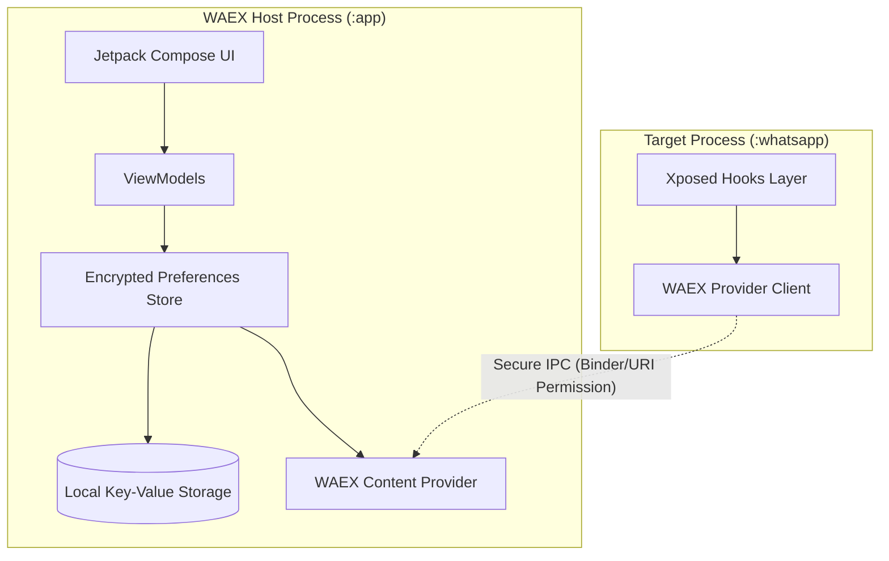

# WAEX Preference System Architecture

This document defines the architectural guidelines and design specifications for the namespace-based preference management system in **Wa Enhancer X** (WAEX). This system completely replaces the flat and obfuscated legacy keys with a searchable, readable, type-safe, and migration-friendly registry.

---

## 🏷️ Naming Rules & Key Standards

All preference keys must strictly follow a **two-level dot-notation namespace** representing the feature's category and specific setting name.

### Syntax
```text
<category>.<keyName>
```

*   **`<category>`**: A lowercase string representing one of the 7 core feature namespaces.
*   **`<keyName>`**: A lowerCamelCase string representing the specific setting. It must be descriptive and self-documenting.

### Naming Conventions
1.  **Toggle Settings**: Prefix with `enable`, `hide`, `show`, `block`, or `force` (e.g. `privacy.enableAntiRevoke`, `system.hideRecommendedChannels`).
2.  **Configurations**: Suffix with the configuration purpose (e.g. `media.maxUploadResolution`, `ai.groqApiKey`).
3.  **Complex Arrays/Lists**: Suffix with `List` or `Json` (e.g. `privacy.blockedCallContactsList`).
4.  **No Abbreviations**: Use `voiceMessage` instead of `vm`, `duration` instead of `dur`.

---

## 🗂️ Categories

All preference keys are partitioned into the following 7 core namespaces:

| Namespace | Category | Purpose | Example Key |
|---|---|---|---|
| `privacy` | Privacy | Identity and stealth settings. | `privacy.freezeLastSeen` |
| `media` | Media | Media upload, download, and quality controls. | `media.enableCallRecording` |
| `messaging` | Messaging | Chat behavior overrides and UI shortcuts. | `messaging.unlimitedPinnedChats` |
| `automation` | Automation | Automated messaging and status posting. | `automation.messageBomber` |
| `ai` | AI | Artificial Intelligence transcription and analysis. | `ai.audioTranscription` |
| `system` | System | UI themes, custom DPI, and compatibility modes. | `system.compatibilityMode` |
| `premium` | Premium | Licensing validation and Pro feature locks. | `premium.licenseKey` |

---

## 💾 Storage Strategy & IPC Security

WAEX operates in a dual-process Android environment: the target application process (WhatsApp) and the host control process (WAEX Manager App). To support this safely, preferences must be stored and accessed securely.



### 1. Local Storage
*   **Encrypted Preferences**: Sensitive preferences (such as licensing details `premium.licenseKey` or API tokens `ai.groqApiKey`) must be stored using Android's Keystore-backed **EncryptedSharedPreferences** to prevent extraction from rooted devices.
*   **Standard Preferences**: Non-sensitive UI preferences are persisted in a sandboxed XML file via the modern **Jetpack DataStore** API, offering transactional, thread-safe asynchronous disk writes.

### 2. Secure Inter-Process Communication (IPC)
*   **Content Provider Channel**: Settings are served from the WAEX Host Process to the target process hook layer using a custom Android `ContentProvider` backed by signature-level permissions (`signatureOrSystem`).
*   **Dynamic Binder Validation**: When the target hook client queries preferences, the `ContentProvider` validates the client’s UID and signature matches the target WhatsApp process before returning the cursor payload.

---

## 🛡️ Validation Rules & Type Safety

To ensure stability across target application updates, every preference key is validated against strict constraints upon both read and write cycles.

### 1. Schema Definition Contracts
Every key must register a schema contract defining:
-   **Type Constraint**: Standard types (`Boolean`, `Integer`, `Float`, `String`, `StringList`).
-   **Default Value**: A fallback value guaranteed to be returned if the key is missing or corrupted.
-   **Value Range Constraints**:
    *   *Numeric*: Minimum and maximum bounds (e.g. `media.maxFps` is constrained to `[30, 120]`).
    *   *Strings*: Allowed enum matches or Regex patterns (e.g. `system.themeStyle` is matched against `["default", "obsidian", "lite"]`).

### 2. Fallback Recovery Flow
If a configuration read fails due to deserialization issues (e.g., a String containing non-integer values when reading an integer key):
1.  Catch the Exception inside `RunCatchingUtil`.
2.  Emit an error telemetry log to local diagnostics.
3.  Write the defined Default Value back to storage.
4.  Return the Default Value to the hook layer to prevent app crashes.

---

## 🔄 Future Migration Strategy

A schema versioning and transformation pipeline is required to prevent settings loss when introducing new features or upgrading schemas.

### 1. Schema Versioning
*   Persistent storage maintains a metadata key `system.preferenceSchemaVersion` (Integer).
*   Any modification to key names, types, or namespaces must increment this schema version.

### 2. Transformation Pipeline (Upgrade/Downgrade Adapters)
When the WAEX Host App boots, the Preference Engine checks `system.preferenceSchemaVersion`. If it is less than the current engine version, a series of sequential **Migration Adapters** is run:

```text
Database Load -> Identify Version X -> Run Migration(X -> X+1) -> Run Migration(X+1 -> X+2) -> Write Final Version
```

*   **Upgrade Schema Mapping**: An adapter defines a key mapping dictionary. For example, upgrading from version 1 to 2:
    *   Map legacy key `antirevoke` to `privacy.enableAntiRevoke` (converting the string `"0"`/`"1"` to `Boolean`).
    *   Map legacy key `downloadviewonce` to `media.enableDownloadViewOnce` (`Boolean`).
*   **Downgrade Strategy**: If a user downgrades the WAEX APK version, settings unrecognized by the older schema are ignored but preserved in storage, preventing data destruction.
